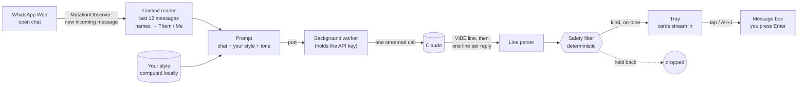

# Charmly

**Better replies, in your own voice.**

Charmly is a Chrome extension for WhatsApp Web. When a new message arrives in the chat you have open, it reads the conversation, gets the vibe, and suggests three replies that sound like *you*: warm, playful, direct, or flirty if you've opted in. Tap one and it goes into your message box. You edit it or press Enter yourself. **Charmly never sends anything.**


## The experience

- **It just appears.** A new incoming message triggers suggestions automatically after a short pause (people often send several messages in a row). They stream in one by one, so the first option shows almost immediately.
- **A read of the vibe.** "excited · sharing news · English + Tamil". If the other person seems tired or wants space, Charmly says so, keeps every option gentle and switches flirty off.
- **Your voice, learnt locally.** Charmly builds a small style profile from your own sent messages: typical length, emoji habits, lowercase or not, your "haha"s and "da"s. Only that summary is kept, it's visible in the popup, and you can clear it with one click.
- **Tones on tap.** Warm, Playful, Direct, and Flirty (opt-in) chips change which kind of reply leads.
- **Polish my draft.** Start typing your own reply and Charmly offers to polish it in your voice.
- **Keyboard first.** `Alt+1/2/3` inserts a suggestion, `Alt+R` regenerates, `Alt+P` polishes your draft, `Esc` tucks the tray away.
- **Native feel.** A glass tray docked above the message box that follows WhatsApp's light or dark theme, measured from the page itself rather than the system setting.

<p align="center"> &nbsp; </p>

## How it works



**Context → tone → writer, in one call.** The Lab card describes a three-step chain. Here it runs as a single streamed request, so the latency is one round trip. Claude first writes a `VIBE|mood|intent|language|boundary` line, then one `n|tone|reply|why` line per option. The parser emits each record as soon as its line completes, so the vibe and the first card appear while the rest are still being written.

**The safety filter is code, not a prompt.** Every suggestion passes a deterministic check before it can be shown:
- it drops unkind or crude lines
- it drops invented phone numbers, emails and addresses
- it drops anything that breaks character ("As an AI")
- it drops flirty options unless you opted in, and always when the other person signals they want space
- in that case it also drops pushy phrasing ("come on", "just one")
- it normalises em dashes to hyphens

The tray tells you how many options it held back.

**Isolated from WhatsApp.** The tray renders in a shadow root, so neither side's CSS leaks into the other. Everything Charmly knows about WhatsApp's markup lives in one adapter, [`src/content/whatsapp.ts`](extension/src/content/whatsapp.ts):

| What it reads | Hook |
|---|---|
| Messages | `[data-pre-plain-text]` |
| Direction | `.message-in` / `.message-out` |
| Emoji | image `alt` text |
| Message box | the footer's contenteditable |

The adapter includes a health check the popup shows, so if WhatsApp changes its page you see "Can't find the message box" instead of silence.

**Inserting text the way a person would.** WhatsApp's editor keeps its own state, so writing to the DOM directly doesn't stick. Charmly selects the box's content and uses the editor's own input path (`insertText`), with a synthetic paste as a fallback.

## Privacy and safety

- Reads only the chat you have open, and only while Charmly is on.
- Sends the last 12 messages, labelled `Them` and `Me`, with no names or numbers, to Claude through Anthropic's API using **your** key. The key lives in the extension's local storage and is only used by its background worker. Nothing goes anywhere else, and there is no Charmly server.
- Never sends a message, never clicks anything, never acts on your account.
- **Demo mode** works with no key at all, using built-in sample suggestions.
- Charmly is an independent project, not affiliated with WhatsApp or Meta. WhatsApp Web's page can change without notice, and the adapter is built to fail visibly when it does.

## Install

```bash
cd extension
pnpm install
pnpm build          # → extension/dist
```

Then open `chrome://extensions`, switch on **Developer mode**, choose **Load unpacked**, and select `extension/dist`. Open web.whatsapp.com, click the Charmly icon, and either paste an Anthropic API key (**Save & test**) or keep **Demo mode** on.

## Tests

```bash
pnpm typecheck && pnpm test   # adapter, stream parser, safety filter, voice profile, prompt, demo
pnpm e2e                      # the real extension in Chrome, on a local chat page
```

`fixtures/chat.html` is a local test page that reproduces just the WhatsApp Web hooks Charmly reads. The end-to-end run loads the built extension into Chrome through puppeteer, simulates incoming messages, and checks the experience:

```
  ✓ docks as a small pill above the message box
  ✓ streams three suggestions (3)
  ✓ reads the vibe: "excited · sharing news · English"
  ✓ matches the chat's light theme
  ✓ tapping a card inserts it into the message box
  ✓ nothing is sent automatically
  ✓ confirms the insert and hands control back
  ✓ Alt+2 inserts the second option
  ✓ Escape tucks the tray away
  ✓ offers to polish the draft you have
  ✓ notices they may want space
  ✓ keeps every option gentle (warm, playful, direct)
  ✓ tone chips change the lead option (playful)
  ✓ follows the dark theme
```

## Layout

```
extension/
  src/content/     whatsapp.ts (the page adapter) · tray.ts + tray.css (the UI) · index.ts (observer, keys)
  src/background/  the only code that talks to Claude
  src/shared/      parse.ts · safety.ts · style.ts · prompt.ts · demo.ts · types.ts
  src/popup/       settings, your voice, health
  fixtures/        chat.html, the local test page
  e2e/run.mjs      end-to-end checks and README screenshots
  build.mjs        esbuild → MV3 bundle; --dev also allows localhost for the test page
```

---

Part of [the Lab](https://balajisriraj.com/#lab), ten agentic products by [Balaji Sri Raj](https://balajisriraj.com).
