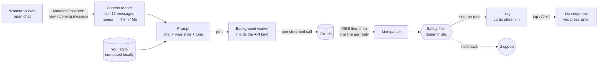

# Charmly

**Better replies, in your own voice.**

Charmly is a Chrome extension for WhatsApp Web. When a new message arrives in the chat you have open, it reads the conversation, gets the vibe, and suggests three replies that sound like *you*: warm, playful, direct, or flirty if you've opted in. Tap one and it goes into your message box. You edit it or press Enter yourself. **Charmly never sends anything.**


## The experience

- **It just appears.** A new incoming message triggers suggestions automatically after a short pause (people often send several messages in a row). They stream in one by one, so the first option shows almost immediately.
- **A read of the vibe.** "excited · sharing news · English + Tamil". If the other person seems tired or wants space, Charmly says so, keeps every option gentle and switches flirty off.
- **Your voice, learnt locally.** Charmly builds a small style profile from your own sent messages: typical length, emoji habits, lowercase or not, your "haha"s and "da"s. Only that summary is kept, it's visible in the popup, and you can clear it with one click.
- **Tones on tap.** Warm, Playful, Direct, and Flirty (opt-in) chips change which kind of reply leads.
- **Polish my draft.** Start typing your own reply and Charmly offers to polish it in your voice.
- **Keyboard first.** `Alt+1/2/3` inserts a suggestion, `Alt+R` regenerates, `Alt+P` polishes your draft, `Esc` tucks the tray away.
- **Three engines.** **On-device** runs a small model on your laptop through [Ollama](https://ollama.com), so your chats never leave the machine. **Claude** gives the best quality with your Anthropic key. **Demo** lets you try the experience with built-in samples.
- **Native feel.** A glass tray docked above the message box that follows WhatsApp's light or dark theme, measured from the page itself rather than the system setting.

<p align="center"> &nbsp; </p>

## How it works



**Context → tone → writer, in one call.** The Lab card describes a three-step chain. Here it runs as a single streamed request, so the latency is one round trip. Claude first writes a `VIBE|mood|intent|language|boundary` line, then one `n|tone|reply|why` line per option. The parser emits each record as soon as its line completes, so the vibe and the first card appear while the rest are still being written.

**The safety filter is code, not a prompt.** Every suggestion passes a deterministic check before it can be shown:
- it drops unkind or crude lines
- it drops invented phone numbers, emails and addresses
- it drops anything that breaks character ("As an AI")
- it drops flirty options unless you opted in, and always when the other person signals they want space
- in that case it also drops pushy phrasing ("come on", "just one")
- it normalises em dashes to hyphens

The tray tells you how many options it held back.

**Isolated from WhatsApp.** The tray renders in a shadow root, so neither side's CSS leaks into the other. Everything Charmly knows about WhatsApp's markup lives in one adapter, [`src/content/whatsapp.ts`](extension/src/content/whatsapp.ts):

| What it reads | Hook |
|---|---|
| Messages | `[data-pre-plain-text]` |
| Direction | `.message-in` / `.message-out` |
| Emoji | image `alt` text |
| Message box | the footer's contenteditable |

The adapter includes a health check the popup shows, so if WhatsApp changes its page you see "Can't find the message box" instead of silence.

**Inserting text the way a person would.** WhatsApp's editor keeps its own state, so writing to the DOM directly doesn't stick. Charmly selects the box's content and uses the editor's own input path (`insertText`), with a synthetic paste as a fallback.

## On-device with Ollama

```bash
brew install ollama          # or download it from ollama.com
ollama serve                 # if the app isn't already running
ollama pull llama3.2:3b      # about 2 GB; quick on an M1, natural for chat
```

In Charmly's popup choose **On-device**. It lists the models you've pulled, picks the smallest, and **Test model** shows a real reply and how long it took. On an M1 with 16 GB, `llama3.2:3b` puts the first suggestion on screen in about a second and all three in about three, once the model is warm. Charmly keeps it loaded between messages.

Small models need more help than Claude, so the on-device path is tuned for them:

- **A shorter prompt with one worked example.** Small models copy an example far more reliably than they follow rules.
- **A forgiving parser.** It handles what models actually emit: echoed templates (`1|tone|reply|why`), un-numbered `Warm: …` lines, a vibe written as a numbered line, `**bold**` numbering, and `<think>` blocks from reasoning models (stripped even when the tags are split across stream chunks). It stops at three options, and if nothing parses it salvages plain lines.
- **A local safety floor.** Small models often skip the vibe line, so Charmly reads the last message itself, instantly. If either that read or the model sees the other person pulling back, flirty and pushy options stay off. The same floor applies to Claude.
- **No setup surprises.** By default Ollama rejects chat requests from browser extensions, so they'd fail unless you restart it with `OLLAMA_ORIGINS`. Instead, Charmly adds a `declarativeNetRequest` rule that removes the `Origin` header only on requests Charmly itself sends to localhost (`initiatorDomains` is Charmly's own ID, so no web page can use it). Ollama then treats them like a local `curl`.

## Privacy and safety

- Reads only the chat you have open, and only while Charmly is on.
- **On-device:** the chat is read and answered on your laptop. Nothing leaves it.
- **Claude:** the last 12 messages, labelled `Them` and `Me` with no names or numbers, go to Anthropic's API using **your** key. The key lives in the extension's local storage and is only used by its background worker.
- There is no Charmly server.
- Never sends a message, never clicks anything, never acts on your account.
- **Demo mode** works with no key at all, using built-in sample suggestions.
- Charmly is an independent project, not affiliated with WhatsApp or Meta. WhatsApp Web's page can change without notice, and the adapter is built to fail visibly when it does.

## Install

```bash
cd extension
pnpm install
pnpm build          # → extension/dist
```

Then open `chrome://extensions`, switch on **Developer mode**, choose **Load unpacked**, and select `extension/dist`. Open web.whatsapp.com, click the Charmly icon, and pick an engine: **On-device** (see below), **Claude** (paste an Anthropic API key and **Save & test**), or **Demo**.

## Tests

```bash
pnpm typecheck && pnpm test   # adapter, stream parser (incl. small-model output), safety filter, voice profile, Ollama client
pnpm e2e                      # the real extension in Chrome, on a local chat page
```

`fixtures/chat.html` is a local test page that reproduces just the WhatsApp Web hooks Charmly reads. The end-to-end run loads the built extension into Chrome through puppeteer, simulates incoming messages, and checks the experience:

```
  ✓ docks as a small pill above the message box
  ✓ streams three suggestions (3)
  ✓ reads the vibe: "excited · sharing news · English"
  ✓ matches the chat's light theme
  ✓ tapping a card inserts it into the message box
  ✓ nothing is sent automatically
  ✓ confirms the insert and hands control back
  ✓ Alt+2 inserts the second option
  ✓ Escape tucks the tray away
  ✓ offers to polish the draft you have
  ✓ notices they may want space
  ✓ keeps every option gentle (warm, playful, direct)
  ✓ tone chips change the lead option (playful)
  ✓ follows the dark theme
  ✓ lists local models (llama3.2:3b)
  ✓ on-device engine streams suggestions
  ✓ on-device replies (3): "okay, let's not push you today, take a rest" · "snooze fest planned 😴👍" · "no worries, sleep tight, we can catch up soon"
  ✓ labels the tray on-device
  ✓ keeps the space-aware read on-device
```

By default the on-device checks run against a stand-in that speaks Ollama's API and answers in a deliberately messy small-model format, so CI covers them. `OLLAMA_E2E=http://localhost:11434 OLLAMA_MODEL=llama3.2:3b pnpm e2e` runs them against a real model, which produced the output above.

## Layout

```
extension/
  src/content/     whatsapp.ts (the page adapter) · tray.ts + tray.css (the UI) · index.ts (observer, keys)
  src/background/  the only code that talks to a model (Claude, Ollama or demo)
  src/shared/      parse.ts · safety.ts · style.ts · prompt.ts · ollama.ts · demo.ts · types.ts
  src/popup/       settings, your voice, health
  fixtures/        chat.html, the local test page
  e2e/run.mjs      end-to-end checks and README screenshots
  build.mjs        esbuild → MV3 bundle; --dev also allows localhost for the test page
```

---

Part of [the Lab](https://balajisriraj.com/#lab), ten agentic products by [Balaji Sri Raj](https://balajisriraj.com).
