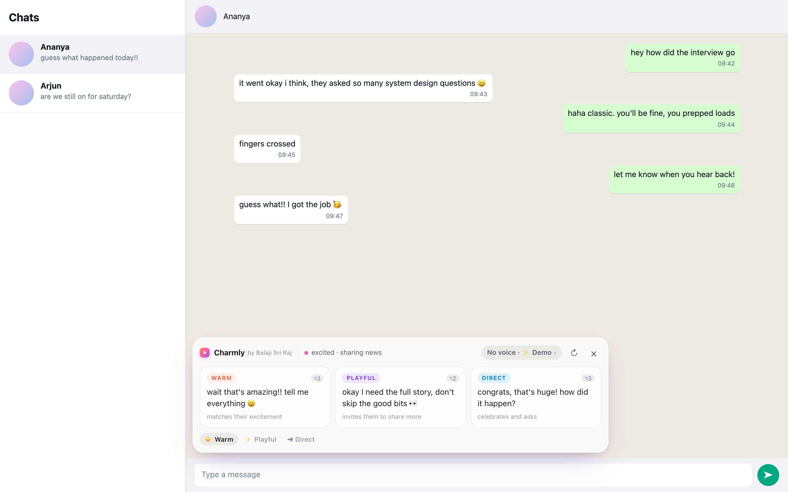
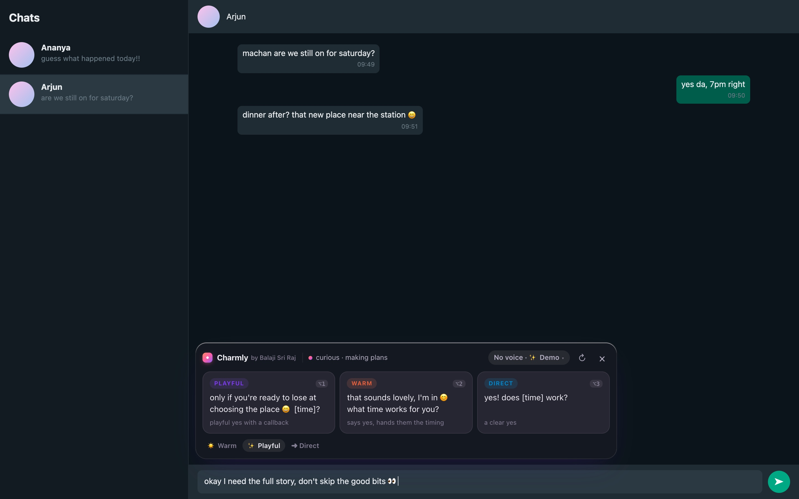
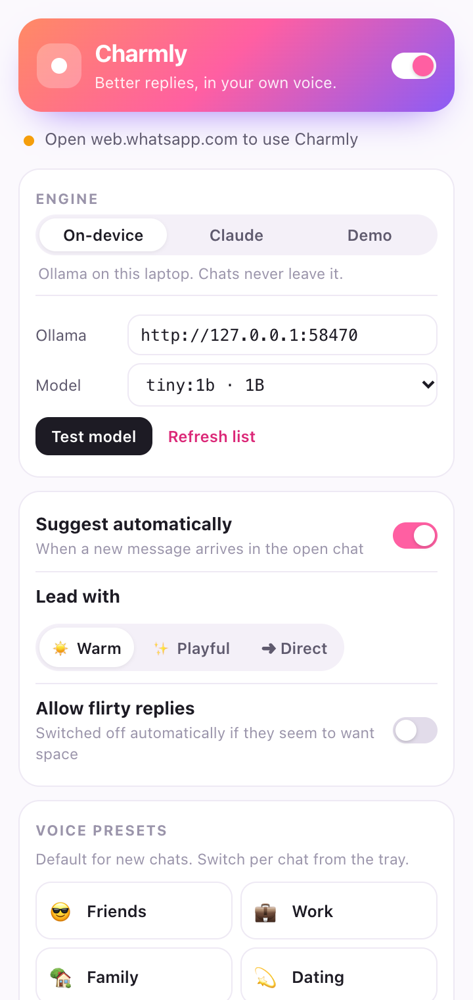
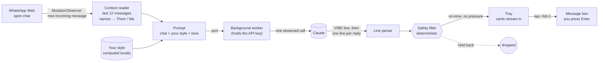
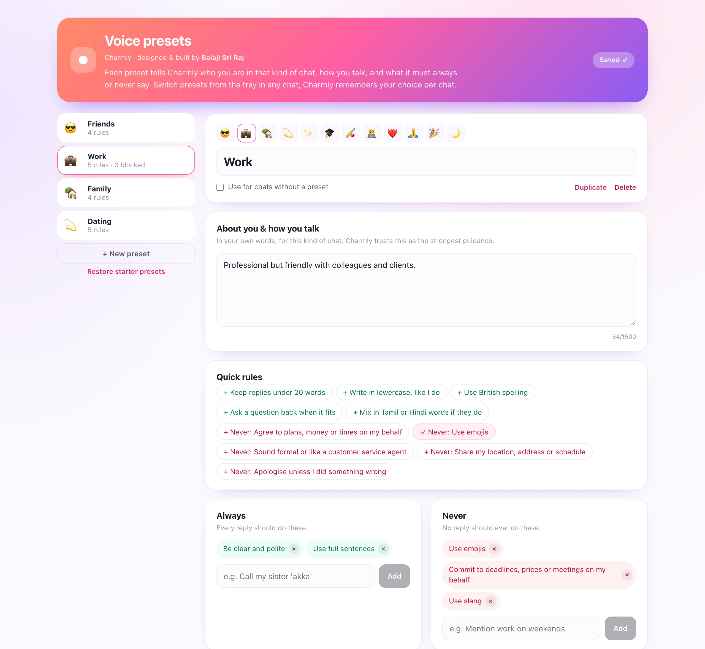
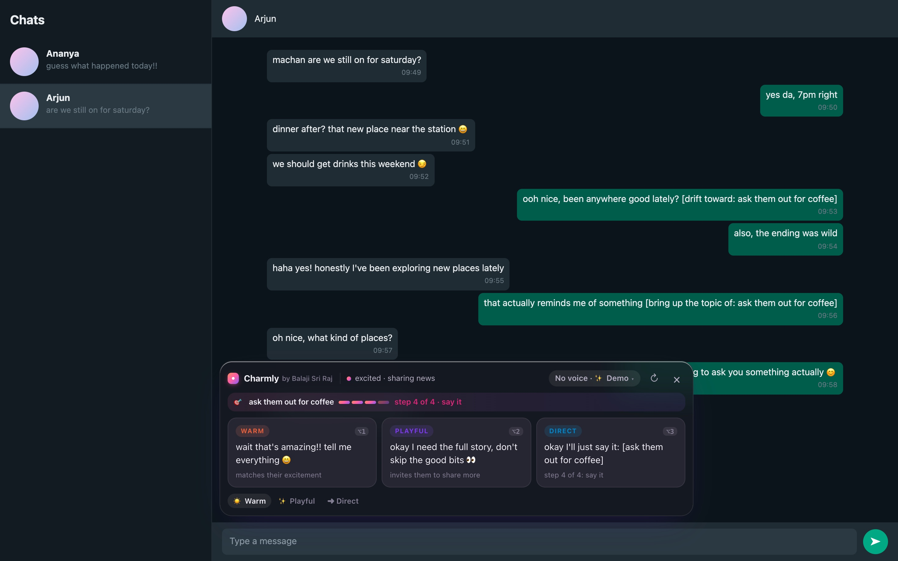
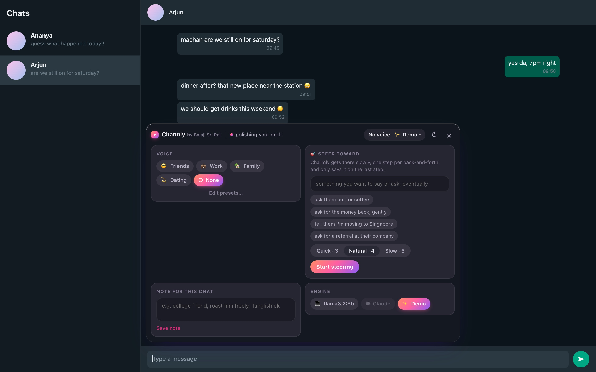

# Charmly

**Better replies, in your own voice.**

Charmly is a Chrome extension for WhatsApp Web. When a new message arrives in the chat you have open, it reads the conversation, gets the vibe, and suggests three replies that sound like *you*: warm, playful, direct, or flirty if you've opted in. Tap one and it goes into your message box. You edit it or press Enter yourself. **Charmly never sends anything.**



## The experience

- **It just appears.** A new incoming message triggers suggestions automatically after a short pause (people often send several messages in a row). They stream in one by one, so the first option shows almost immediately.
- **A read of the vibe.** "excited · sharing news · English + Tamil". If the other person seems tired or wants space, Charmly says so, keeps every option gentle and switches flirty off.
- **Your voice, learnt locally.** Charmly builds a small style profile from your own sent messages: typical length, emoji habits, lowercase or not, your "haha"s and "da"s. Only that summary is kept, it's visible in the popup, and you can clear it with one click.
- **Tones on tap.** Warm, Playful, Direct, and Flirty (opt-in) chips change which kind of reply leads. Charmly names the three tones to write, in order, so the one you tap always comes first, and in flirt mode a flirty option stays in the mix.
- **Steer toward what you want to say.** Some things are better reached than blurted: asking someone out, asking for money back, telling a friend you're moving. Set a goal and a pace (3, 4 or 5 exchanges), and Charmly drives the chat there slowly: one step per back-and-forth, and it only says it on the last step. [More below](#steer).
- **Polish my draft.** Start typing your own reply, whether the tray is tucked away or showing suggestions, and Charmly offers to polish it in your voice.
- **Keyboard first.** `Alt+1/2/3` inserts a suggestion, `Alt+R` regenerates, `Alt+P` polishes your draft, `Esc` tucks the tray away.
- **One chip for everything about a chat.** The tray has one line of context: the vibe, plus a chip summing up this chat's setup ("😎 Friends · 💻 llama3.2:3b"). The chip opens a single sheet with the voice preset, the goal, a note and the engine. A thin goal strip shows only while you're steering.
- **Voice presets.** Tell Charmly who you are and how you talk in each kind of chat: what to always do, what never to do, and words it must never use. Four editable starters ship (😎 Friends, 💼 Work, 🏡 Family, 💫 Dating), and you can add your own. Switch presets from the tray's sheet, which also holds a note for the chat ("my manager: keep it brief"). Charmly remembers both per chat.
- **Three engines, switchable in the chat.** The sheet lists your installed local models, plus Claude and Demo. **On-device** runs a small model on your laptop through [Ollama](https://ollama.com), so your chats never leave the machine. **Claude** gives the best quality with your Anthropic key. **Demo** lets you try the experience with built-in samples.
- **Native feel.** A glass tray docked above the message box that follows WhatsApp's light or dark theme, measured from the page itself rather than the system setting.

<p align="center"> &nbsp; </p>

## How it works



**Context → tone → writer, in one call.** The Lab card describes a three-step chain. Here it runs as a single streamed request, so the latency is one round trip. Claude first writes a `VIBE|mood|intent|language|boundary` line, then one `n|tone|reply|why` line per option. The parser emits each record as soon as its line completes, so the vibe and the first card appear while the rest are still being written.

**The safety filter is code, not a prompt.** Every suggestion passes a deterministic check before it can be shown:
- it drops pressure and coercion ("or else", "you owe me", "you have to reply"). Banter and swearing are left to you: these are your own chats, and the replies match how the chat already talks
- it drops invented phone numbers, emails and addresses
- it drops anything that breaks character ("As an AI")
- it drops flirty options unless you opted in, and always when the other person signals they want space
- in that case it also drops pushy phrasing ("come on", "just one")
- it normalises em dashes to hyphens

The tray tells you how many options it held back.

**Isolated from WhatsApp.** The tray renders in a shadow root, so neither side's CSS leaks into the other. Everything Charmly knows about WhatsApp's markup lives in one adapter, [`src/content/whatsapp.ts`](extension/src/content/whatsapp.ts):

| What it reads | Hook |
|---|---|
| Messages | `[data-pre-plain-text]` |
| Direction | `.message-in` / `.message-out` |
| Emoji | image `alt` text |
| Message box | the footer's contenteditable |

The adapter includes a health check the popup shows, so if WhatsApp changes its page you see "Can't find the message box" instead of silence.

**Inserting text the way a person would.** WhatsApp's editor keeps its own state, so writing to the DOM directly doesn't stick. Charmly selects the box's content and uses the editor's own input path (`insertText`), with a synthetic paste as a fallback.

## Voice presets



Each preset is your voice for one kind of chat:
- **About you & how you talk:** free text in your own words, the strongest guidance.
- **Always** and **Never:** rules, with one-tap quick rules for the common ones ("Never agree to plans, money or times on my behalf").
- **Never use these words:** enforced in code by the safety filter, so a suggestion containing one is dropped whatever the model writes.

The editor shows exactly what Charmly adds to each request. A chat uses the preset you picked for it in the tray, or your default. The preset and any chat note reach Claude, the on-device model and the filter alike. Chat names, presets and notes are stored only in your browser.

## Steer



A goal is a quiet instruction for one chat, like "ask them out for coffee", reached **slowly**. The plan is in code, not left to the model:

| Pace | Steps, one per back-and-forth |
|---|---|
| Quick · 3 | find common ground → bridge to the topic → say it |
| Natural · 4 | find common ground → bridge to the topic → test the water → say it |
| Slow · 5 | build rapport → find common ground → bridge to the topic → test the water → say it |

- **Steps follow the conversation, not the history.** A new goal always starts at step 1, however long the chat already is. Your reply finishes a step; their answer starts the next. Several messages in a row count once.
- **The ask is held back, twice.** Each request names the current step and tells the model that no option may say it before the last step. Code backs that up: before the last step, an option that makes the ask (an invitation like "want to / can we / if you're free" with the goal's topic) is held back, unless they opened the door themselves. On the last step, all three options say it, in different ways.
- **The strip in the tray** shows the plan as bars, where you are ("step 2 of 4 · bridge to the topic, not saying it yet"), and "step 2 done, next when they reply" after you send. Once the tray is tucked away, the pill keeps a small "🎯 2/4" chip.
- **You stay in charge.** **Skip ›** moves on by hand. If they bring the topic up themselves ("need a coffee so badly"), the strip offers **Say it now ›**. If they seem to want space, the plan pauses and holds its step. After you've said it, **Done ✓** ends the goal, or **Keep going** keeps steering.
- **Honest by design.** The prompt rules out tricks, false pretexts, guilt and pressure.

Claude gets the whole plan and reports whether they've opened the door themselves (a `GOAL|yes/no|note` line). The on-device model gets a two-line version of the current step, which small models follow more reliably, and Charmly spots the door-opening itself. Goals and their steps are stored per chat in your browser.

<p align="center"></p>

## On-device with Ollama

```bash
brew install ollama          # or download it from ollama.com
ollama serve                 # if the app isn't already running
ollama pull llama3.2:3b      # about 2 GB; quick on an M1, natural for chat
```

In Charmly's popup choose **On-device**. It lists the models you've pulled, picks the smallest, and **Test model** shows a real reply and how long it took. On an M1 with 16 GB, `llama3.2:3b` puts the first suggestion on screen in about a second and all three in about three, once the model is warm. Charmly keeps it loaded between messages.

Small models need more help than Claude, so the on-device path is tuned for them:

- **A shorter prompt with one worked example.** Small models copy an example far more reliably than they follow rules.
- **A forgiving parser.** It handles what models actually emit: echoed templates (`1|tone|reply|why`), un-numbered `Warm: …` lines, a vibe written as a numbered line, `**bold**` numbering, and a tone on one line with the reply on the next, extra label fields, `<think>` blocks from reasoning models (stripped even when the tags are split across stream chunks). It stops at three options, and if nothing parses it salvages plain lines.
- **A local safety floor.** Small models often skip the vibe line, so Charmly reads the last message itself, instantly. If either that read or the model sees the other person pulling back, flirty and pushy options stay off. The same floor applies to Claude.
- **No setup surprises.** By default Ollama rejects chat requests from browser extensions, so they'd fail unless you restart it with `OLLAMA_ORIGINS`. Instead, Charmly adds a `declarativeNetRequest` rule that removes the `Origin` header only on requests Charmly itself sends to localhost (`initiatorDomains` is Charmly's own ID, so no web page can use it). Ollama then treats them like a local `curl`.

## Privacy and safety

- Reads only the chat you have open, and only while Charmly is on.
- **On-device:** the chat is read and answered on your laptop. Nothing leaves it.
- **Claude:** the last 12 messages, labelled `Them` and `Me` with no names or numbers, go to Anthropic's API using **your** key. The key lives in the extension's local storage and is only used by its background worker.
- There is no Charmly server.
- Never sends a message, never clicks anything, never acts on your account.
- **Demo mode** works with no key at all, using built-in sample suggestions.
- Charmly is an independent project, not affiliated with WhatsApp or Meta. WhatsApp Web's page can change without notice, and the adapter is built to fail visibly when it does.

## Install

```bash
cd extension
pnpm install
pnpm build          # → extension/dist
```

Then open `chrome://extensions`, switch on **Developer mode**, choose **Load unpacked**, and select `extension/dist`. Open web.whatsapp.com, click the Charmly icon, and pick an engine: **On-device** (see below), **Claude** (paste an Anthropic API key and **Save & test**), or **Demo**.

## Tests

```bash
pnpm typecheck && pnpm test   # adapter, stream parser (incl. small-model output), safety filter, voice profile, Ollama client
pnpm e2e                      # the real extension in Chrome, on a local chat page
```

`fixtures/chat.html` is a local test page that reproduces just the WhatsApp Web hooks Charmly reads. The end-to-end run loads the built extension into Chrome through puppeteer, simulates incoming messages, and checks the experience:

```
  ✓ docks as a small pill above the message box
  ✓ credits Balaji Sri Raj in the tray
  ✓ streams three suggestions (3)
  ✓ reads the vibe: "excited · sharing news"
  ✓ matches the chat's light theme
  ✓ tapping a card inserts it into the message box
  ✓ nothing is sent automatically
  ✓ confirms the insert and hands control back
  ✓ Alt+2 inserts the second option
  ✓ Escape tucks the tray away
  ✓ offers to polish the draft you have
  ✓ notices they may want space
  ✓ keeps every option gentle (warm, playful, direct)
  ✓ tone chips change the lead option (playful)
  ✓ follows the dark theme
  ✓ flirt mode: Warm leads and stays selected (warm, chip ☀️ Warm)
  ✓ flirt mode: Direct leads and stays selected (direct, chip ➜ Direct)
  ✓ flirt mode: Flirty leads and stays selected (flirty, chip 💫 Flirty)
  ✓ typing while suggestions are open offers Polish
  ✓ polishes that draft, then hides the offer
  ✓ one sheet holds voice, goal, note and engine
  ✓ goal pace: Quick, Natural or Slow, Natural by default
  ✓ an example fills the goal
  ✓ starts at step 1 of 4 even in a chat with history ("step 1 of 4 · find common ground, not saying it yet")
  ✓ holds the ask back
  ✓ no suggestion says it on step 1
  ✓ after you reply, the pill shows "1/4 · waiting for them"
  ✓ two messages in a row still count as one step
  ✓ suggestions take step 2
  ✓ drives the chat step by step: find common ground → bridge to the topic → test the water → say it
  ✓ only the last step says it
  ✓ after you send it, the goal shows as said
  ✓ Stop ends steering
  ✓ Quick pace plans three steps
  ✓ they mention it first: offers 'Say it now' ("they brought it up themselves")
  ✓ Say it now jumps to the last step
  ✓ pauses when they want space ("paused, they may want space")
  ✓ and holds the step
  ✓ Skip › moves on by hand
  ✓ another chat has no goal
  ✓ the goal and its step are remembered for this chat (2/4)
  ✓ lists local models (tiny:1b)
  ✓ the sheet lists the starter presets
  ✓ the chat now shows the Work preset
  ✓ on-device engine streams suggestions
  ✓ on-device replies (2): "recharge mode activated 🔋 talk tomorrow?" · "all good, message me whenever"
  ✓ the tray shows the on-device model (💼 Work · 💻 tiny:1b · ✎ ▾)
  ✓ keeps the space-aware read on-device
  ✓ sent a streaming chat request to Ollama
  ✓ the Work preset's rules reach the model
  ✓ the chat note reaches the model
  ✓ the goal's current step reaches the on-device model
  ✓ a word blocked in the preset is never shown
  ✓ preset and note are remembered for this chat
  ✓ the engine menu lists local models (tiny:1b)
  ✓ switches to Demo from the tray
  ✓ and back to the local model
```

By default the on-device checks run against a stand-in that speaks Ollama's API and answers in a deliberately messy small-model format, so CI covers them. `OLLAMA_E2E=http://localhost:11434 OLLAMA_MODEL=llama3.2:3b pnpm e2e` runs them against a real model, which also passes.

## Layout

```
extension/
  src/content/     whatsapp.ts (the page adapter) · tray.ts + tray.css (the UI) · index.ts (observer, keys)
  src/background/  the only code that talks to a model (Claude, Ollama or demo)
  src/shared/      parse.ts · safety.ts · style.ts · prompt.ts · ollama.ts · demo.ts · types.ts
  src/popup/       engine, default preset, your voice, health
  src/options/     the voice-preset editor
  fixtures/        chat.html, the local test page
  e2e/run.mjs      end-to-end checks and README screenshots
  build.mjs        esbuild → MV3 bundle; --dev also allows localhost for the test page
```

## Credit and licence

Charmly is designed and built by [Balaji Sri Raj](https://balajisriraj.com). The credit appears in the tray, the popup, the presets page, the extension's manifest and the top of every built file. You're welcome to read the code and run Charmly for yourself. Copies and forks must keep that credit visible and may not be used commercially without permission. See [LICENSE](LICENSE).

---

Part of [the Lab](https://balajisriraj.com/#lab), ten agentic products by [Balaji Sri Raj](https://balajisriraj.com).
